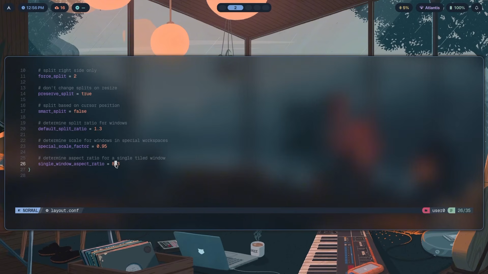

# Визуальное направление

Референсы, по которым настраивается внешний вид. Не копия, а ориентир по настроению.

## reference-01-floating-pills.png

- **Панель сверху без сплошного фона**: отдельные «таблетки» (pills) парят над обоями.
  - слева: логотип, часы, погода, медиа;
  - центр: рабочие столы;
  - справа: системные индикаторы (звук/яркость, сеть), уведомления.
- **Окна**: полупрозрачные с сильным размытием, скруглённые углы, тонкая рамка, отступы от краёв экрана.
- **Палитра**: тёмный сине-бирюзовый фон, тёплые оранжевые и персиковые акценты, вытянутые из обоев.
- **Обои**: иллюстрация, тёплый «уютный» lo-fi.
